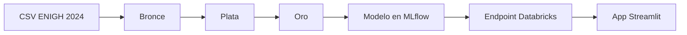
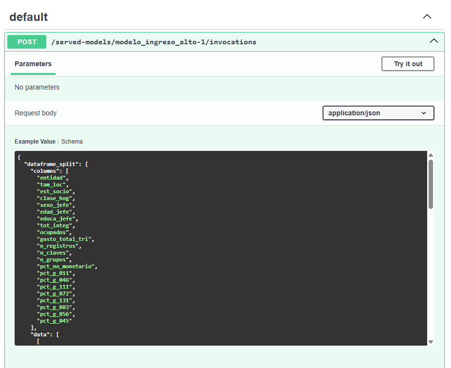

# ¿Es un hogar de ingreso alto? Pipeline Medallion, modelo y API con la ENIGH 2024

Proyecto final de **Machine Learning for Big Data** (Dr. Ramón Alejandro Briseño Martínez).
Autora: Carolina · Maestría en Ingeniería (Ciencia de Datos), Universidad Panamericana.

Proyecto individual. Toma los microdatos de la **ENIGH 2024** (INEGI) y construye, en Databricks, un pipeline por capas (bronce, plata y oro) con Spark, entrena un modelo de clasificación, lo publica como endpoint REST y lo consulta desde una app web.

## Resumen

| Elemento | Detalle |
|---|---|
| Datos | ENIGH 2024, nueva serie ([catálogo INEGI](https://www.inegi.org.mx/rnm/index.php/catalog/1116)): tabla de gastos (**5,311,497 filas**) y concentrado de hogares (**91,414 hogares**) |
| Problema | Clasificación binaria: ¿el hogar está en el 20% de mayor ingreso corriente trimestral? |
| Métrica principal | **F1** (clases desbalanceadas 80/20) |
| Resultado | F1 = **0.70**, recall = 0.86, precision = 0.59, ROC-AUC = 0.94 (baseline: F1 = 0) |
| Plataforma | Databricks (Spark, Delta, Unity Catalog, MLflow, Model Serving) |
| Servicio | Endpoint REST `enigh-ingreso-alto` con esquema OpenAPI |
| Aplicación | Streamlit, consume el endpoint por HTTP |

## Arquitectura



Todas las tablas son Delta, dentro de `workspace.enigh`:

| Capa | Tablas | Qué contiene |
|---|---|---|
| Bronce | `bronce_concentrado`, `bronce_gastos` | Datos tal cual vienen de INEGI, todo como texto, más fecha de ingesta y archivo de origen |
| Plata | `silver_concentrado`, `silver_gastos` | Datos limpios y con tipos correctos |
| Oro | `gold_hogares` | **Una fila por hogar** (91,414 filas, 26 columnas), lista para el modelo |

## Limpieza y transformación (notebooks `01` a `04`)

Las decisiones salen de un perfilado previo (`02_perfilado`):

- **Bronce:** se lee todo como texto (`inferSchema` apagado). La capa conserva el dato crudo y los tipos se corrigen en plata.
- **Duplicados:** 0 en el concentrado (llave `folioviv` + `foliohog`) y 0 filas idénticas en gastos. Se deja un `dropDuplicates` por llave como salvaguarda.
- **Nulos:** las llaves y las columnas del concentrado vienen completas. En gastos, **425,861 filas** traen `gasto_tri` en blanco; de esas, 421,365 tienen monto en `gas_nm_tri`, es decir, son gastos no monetarios (regalos, autoconsumo). Se guardan los dos montos por separado (`gasto_mon_tri`, `gasto_nm_tri`) y se suma un `gasto_total_tri`.
- **Filas sin información:** se descartan **6,300** gastos con total de 0 o sin ningún monto (silver_gastos queda con 5,305,197 filas).
- **Tipos de dato:** `folioviv`, `foliohog`, `ubica_geo` y `upm` quedan como texto con ceros a la izquierda; el resto se convierte con `try_cast` (los valores mal formados quedan nulos en lugar de romper el proceso). Se agrega `entidad` (primeros 2 dígitos de `ubica_geo`) y `grupo3` (primeros 3 dígitos de `clave`).
- **Outliers:** no se eliminan. Un gasto de más de 1 millón de pesos puede ser real (un vehículo, una vivienda) y hay hogares con ingreso de hasta 17.4 millones. El modelo usa árboles, que son robustos a valores extremos, y el corte del 20% superior se define por percentil. Seis hogares con ingreso ≤ 0 se conservan porque son hogares reales.
- **Codificación:** las variables categóricas de INEGI ya vienen como códigos numéricos (estrato, tamaño de localidad, escolaridad, etc.) y se usan como números; el modelo de árboles no necesita normalización.
- **Oro:** los 5.3 millones de gastos se agregan por hogar: gasto total, número de gastos, productos y grupos distintos, porcentaje no monetario y porcentaje del gasto en los 8 grupos de mayor monto (`011`, `046`, `111`, `072`, `131`, `083`, `056`, `045`). Se une con las características del hogar y del jefe(a).

## Definición del problema y métricas (notebook `05`)

- **Tarea:** clasificación binaria. `ingreso_alto = 1` si `ing_cor` ≥ **$99,708.17** (percentil 80 del ingreso corriente trimestral por hogar). Clases: 73,131 hogares en 0 y 18,283 en 1.
- **Sin fuga de información:** ninguna columna de ingreso entra al modelo (`ing_cor` se guarda en oro solo como referencia). Se usan **22 variables**.
- **Separación:** 80% entrenamiento (73,131) y 20% prueba (18,283), estratificada.
- **Por qué F1:** con 80/20, un modelo que siempre responde "no alto" acierta 80% pero tiene F1 = 0 (es el baseline). F1 equilibra precision y recall en la clase minoritaria.
- **Modelo:** `HistGradientBoostingClassifier` (scikit-learn) con pesos balanceados.

| Métrica (prueba) | Valor |
|---|---|
| F1 | 0.7002 |
| Precision | 0.5888 |
| Recall | 0.8635 |
| ROC-AUC | 0.9355 |
| PR-AUC | 0.8093 |

Los pesos balanceados priorizan detectar hogares de ingreso alto (recall alto) a costa de más falsos positivos (precision moderada).

## Publicación del modelo

- El modelo se registra con MLflow en Unity Catalog como `workspace.enigh.modelo_ingreso_alto` (versión 1), con **firma de entradas** y ejemplo de entrada.
- Se publica como endpoint de Databricks Model Serving: `enigh-ingreso-alto`, `POST /serving-endpoints/enigh-ingreso-alto/invocations`, con autenticación por token.
- **Validación de entradas:** la firma de MLflow exige las 22 columnas numéricas; si faltan o tienen un tipo incorrecto, el endpoint responde con error 400.
- **Documentación OpenAPI:** el esquema se obtiene del propio endpoint (`GET /api/2.0/serving-endpoints/enigh-ingreso-alto/openapi`), está en [`openapi.json`](openapi.json) y se visualiza en Swagger Editor. El esquema lista la ruta interna del modelo servido (`/served-models/modelo_ingreso_alto-1/invocations`).



Ejemplo de consulta:

```json
{"dataframe_records": [{"entidad": 14, "tam_loc": 1, "est_socio": 3, "clase_hog": 2, "sexo_jefe": 1,
"edad_jefe": 45, "educa_jefe": 9, "tot_integ": 4, "ocupados": 2, "gasto_total_tri": 90000,
"n_registros": 60, "n_claves": 50, "n_grupos": 20, "pct_no_monetario": 0.05,
"pct_g_011": 0.30, "pct_g_046": 0.05, "pct_g_111": 0.08, "pct_g_072": 0.06,
"pct_g_131": 0.03, "pct_g_083": 0.04, "pct_g_056": 0.03, "pct_g_045": 0.04}]}
```

Respuesta: `{"predictions": [1]}`

## Aplicación de consulta (`app.py`)

App en Streamlit que **consume el endpoint publicado** (no carga ningún modelo local):

- Formulario con los datos del hogar, del jefe(a) y la distribución del gasto.
- **Validación previa** de las entradas (por ejemplo, la suma de porcentajes por grupo no puede pasar de 1).
- **Tiempo de espera** de 5 s para conectar y 60 s para recibir respuesta, con **3 reintentos** (el endpoint escala a cero cuando no se usa y la primera consulta puede tardar).
- **Manejo de errores:** token inválido (401/403), endpoint inexistente (404), datos rechazados (400), servicio no disponible (429/5xx), falta de conexión, y **respuestas con formato inválido**.
- Una sección de "Detalle técnico" muestra la petición enviada y la respuesta cruda.

## Cómo ejecutarlo

**1. Pipeline y modelo (Databricks):**
1. Crear el esquema `workspace.enigh` y el volumen `datos`; subir los CSV de la ENIGH 2024 (`2024concentradohogar` y `2024gastoshogar`).
2. Ejecutar en orden los notebooks de la carpeta `notebooks/`: `01_bronce`, `02_perfilado`, `03_plata`, `04_oro`, `05_entrenamiento`.
3. Crear en **Serving** el endpoint `enigh-ingreso-alto` con el modelo `workspace.enigh.modelo_ingreso_alto`, versión 1.

**2. App (local):**

```
pip install streamlit requests
```

Definir el token de Databricks como variable de entorno (nunca dentro del código):

```
# Anaconda Prompt / cmd
set DATABRICKS_TOKEN=<tu_token>
# PowerShell
$env:DATABRICKS_TOKEN = "<tu_token>"
```

```
streamlit run app.py
```

Si el endpoint está en otro workspace, definir también `ENDPOINT_URL`.

## Limitaciones

- No se usó el factor de expansión de la encuesta: cada hogar cuenta como una fila, así que las métricas describen la muestra y no la población nacional.
- Las variables categóricas se tratan como números (códigos de INEGI); funciona bien con árboles pero no implica un orden real.
- El modelo usa el gasto del hogar para inferir su nivel de ingreso: es una asociación, no una relación causal.
- Es un ejercicio académico; no debe usarse para decidir sobre personas reales.
- La primera consulta tras un periodo de inactividad es lenta por el escalado a cero del endpoint.

## Cómo cumple la rúbrica

| Criterio | Dónde |
|---|---|
| Limpieza y transformación (bronce, plata, oro) | Sección de limpieza y notebooks `01` a `04` |
| Definición del problema y métricas | Sección de definición del problema y notebook `05` |
| Publicación del modelo | Endpoint con firma MLflow, OpenAPI y validación de entradas |
| Integración con la aplicación | `app.py`, con timeouts, reintentos y manejo de errores |

## Estructura del repositorio

```
├── README.md
├── app.py
├── openapi.json
├── swagger.png
└── notebooks/
```